## About

<table>
<tr>
<td width="200" align="center" valign="top">

</td>
<td valign="top">

I'm a Computer Science undergraduate at **NIT Manipur** (B.Tech, 2023–2027) who likes taking an idea all the way to a deployed product. I build full-stack apps with REST APIs, databases and authentication, and add AI features through the OpenAI GPT and Meta Llama APIs.

Right now I'm building **Alercia**, a student study and alarm app, and sharpening my cloud and DevOps skills on AWS.

</td>
</tr>
</table>

## Experience

| Role | When | What I did |
|---|---|---|
| **Software Engineering Fellow**, Headstarter AI (remote) | Aug–Sep 2025 | Shipped 5 full-stack applications in a 5-week sprint cycle. Integrated OpenAI GPT and Meta Llama APIs and deployed with Firebase and Supabase. |
| **Full Stack Development & DevOps Program**, 100xDevs | Jan–May 2026 | Built and deployed 5+ applications on AWS (EC2, S3, Lambda, CloudFormation). Practiced Git, Docker and CI/CD. |

## Selected projects

### Flash: AI Flashcard Generator
Turns uploaded PDFs into structured flashcards using **Llama 3.1** and **LangChain**. Built with Next.js, TypeScript, Firebase, Tailwind CSS, Clerk authentication and Stripe. **16 users on launch day.**

[Source code](https://github.com/banothmahesh1/flashcard-generator) · [Live demo](https://flashcards-orpin-ten.vercel.app/)

### Alercia: Student Alarm & Productivity App *(in progress)*
A study-focused app combining quizzes generated from notes, active recall and spaced repetition. Android app with Expo / React Native, plus a Next.js landing page. **50+ people on the pre-launch waitlist.**

### MCP Server for GitHub
A TypeScript / Node.js server that exposes GitHub API operations as callable tools for AI clients, built with the MCP SDK and Octokit. Tested with Claude Desktop and MCP Inspector.

[Browse my repositories](https://github.com/banothmahesh1?tab=repositories)

## Achievements

- Advanced to **Round 2** of a national-level hackathon
- Solved **400+ problems on LeetCode** in C++, with the 50-Day and 100-Day consistency badges
- Completed the **Deloitte Technology Job Simulation** (Coding & Development) on Forage, Aug 2026
- Completed the **0 to 100 Full Stack Development and DevOps Program** by 100xDevs

## Skills

| | |
|---|---|
| **Languages** | Java, Python, JavaScript, TypeScript, SQL, C++ |
| **Web** | React.js, Next.js, Node.js, Tailwind CSS, Expo / React Native, REST APIs |
| **AI** | OpenAI GPT API, Meta Llama (Llama 3.1), LangChain, Model Context Protocol (MCP) SDK |
| **Cloud & DevOps** | AWS (EC2, S3, Lambda, CloudFormation), Docker, CI/CD, Git & GitHub, Firebase, Supabase |
| **Auth & payments** | Clerk, Stripe |
| **CS fundamentals** | OOP, DBMS, Operating Systems, Computer Networks |

## GitHub activity

Live contribution graph from GitHub data via ghchart.rshah.org.

## Find me

[GitHub](https://github.com/banothmahesh1) · [LinkedIn](https://www.linkedin.com/in/banoth-mahesh-cse) · [LeetCode](https://leetcode.com/u/Banoth_mahesh) · [Portfolio](https://mahesh-portfolio-one-iota.vercel.app/)

